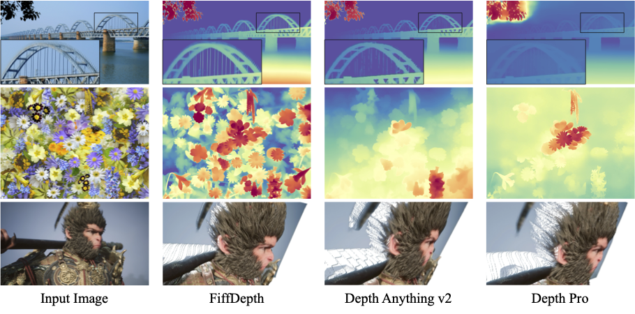

# FiffDepth: Feed-forward Transformation of Diffusion-Based Generators for Detailed Depth Estimation
We propose an efficient MDE approach named FiffDepth. The key feature of FiffDepth is its use of diffusion priors. It transforms diffusion-based image generators into a feed-forward architecture for detailed depth estimation. FiffDepth preserves key generative features and integrates the strong generalization capabilities of models like DINOv2. Through benchmark evaluations, we demonstrate that FiffDepth achieves exceptional accuracy, stability, and fine-grained detail, offering significant improvements in MDE performance against state-of-the-art MDE approaches.




## Environment Setup

To create a Python virtual environment named fiffdepth under the ./venv directory and install all dependencies from requirements.txt, run:

```bash
python3 -m venv ./venv/fiffdepth
source ./envs/fiffdepth/bin/activate
pip install -r requirements.txt
````


## Checkpoint Preparation


Download all checkpoints from [here](https://huggingface.co/yunpeng1998/FiffDepth) and place them under:

./checkpoints/fiffdepth


**This is a retrained checkpoint. Since it was trained with different real image data, its performance may not be optimal.**


## Inference
python run_direct.py --checkpoint './checkpoints/fiffdepth' --sd_ckpt ./checkpoints/fiffdepth' \ --input_rgb_dir input/images --output_dir output/depth


## Citation

```bibtex
@inproceedings{bai2025fiffdepth,
  title={Fiffdepth: Feed-forward transformation of diffusion-based generators for detailed depth estimation},
  author={Bai, Yunpeng and Huang, Qixing},
  booktitle={Proceedings of the IEEE/CVF International Conference on Computer Vision},
  pages={6023--6033},
  year={2025}
}
```

